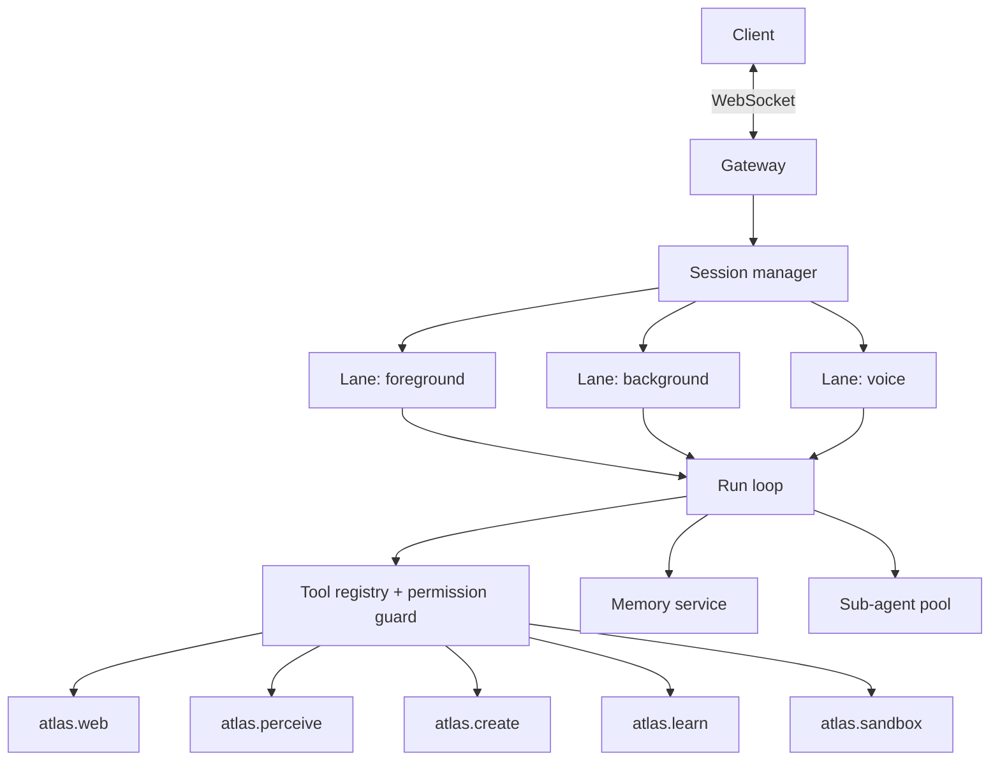

# Agent Harness Spec — Sovereign Agent Atlas

**Status:** Draft v0.1
**Scope:** How the agent runs: gateway, sessions, lanes, tools, sub-agents, skills, context, safety. Memory details live in `MEMORY_PERSONALIZATION_SPEC.md`; the compiler in `COURSE_ENGINE_SPEC.md`.

---

## 1. Design goals

- **Persistent and resumable.** Runs survive app close and reconnects.
- **Interruptible.** User can steer or cancel at any time.
- **Transparent.** Every step is visible, with sources and cost.
- **Budgeted.** No run exceeds user/plan limits.
- **Safe by construction.** Untrusted content never directly drives privileged tools.
- **Self-improving, but gated.** New skills must pass tests before being used.

## 2. Runtime topology



## 3. Sessions and lanes

- **Session** = one conversation context for a learner (plus lesson/lab context if opened from Studio).
- **Lane** = ordered queue inside a session. Runs inside one lane are serial; lanes run in parallel.

| Lane | Used for | Rules |
|---|---|---|
| `foreground` | Chat turns, quick tool calls | Max 1 active run; highest priority |
| `background` | Deep research, course compile, large builds | Checkpointed; progress events; cancellable |
| `voice` | Realtime audio conversation | Barge-in allowed; short outputs; may delegate to `background` |

### Queue modes (when a message arrives during an active run)

| Mode | Behaviour |
|---|---|
| `steer` | Inject at the next tool boundary so the current run changes course |
| `followup` | Queue; start after the current run ends |
| `collect` | Batch rapid messages into a single next turn |
| `interrupt` | Cancel the current run, then start the new one |

Default: `steer` for text while a run is active, `interrupt` for voice barge-in. **[ASSUMPTION]**

## 4. Run loop

1. **Assemble context** (system policy, learner profile slice, retrieved memory, lesson/lab context, tool schemas).
2. **Plan** (short, only for multi-step tasks).
3. **Act:** call model → tool calls → results → repeat.
4. **Guard:** every tool call passes the permission guard and budget check.
5. **Compact** context when near limit (summarise, keep citations and pinned facts).
6. **Finish:** final answer with citations, trace link, cost; write memory (episodic + any candidate skills).

Hard limits per run: max steps, max wall-clock, max tokens, max tool calls per tool. All configurable per plan.

## 5. Tool registry

Each tool has: JSON schema, **permission tier**, cost estimate, timeout, and an audit log entry.

### Permission tiers

| Tier | Meaning | Examples |
|---|---|---|
| **T0 read-only** | No side effects | search, read page, read lesson, read memory |
| **T1 learner-scoped write** | Writes only the user's own data | add note, schedule review, save skill draft |
| **T2 execute** | Runs code in a sandbox | run lab tests, build simulator |
| **T3 publish/share** | Visible to others | publish course, share proof card — **requires user confirmation** |

### 5.1 `atlas.web` (T0)

| Function | Notes |
|---|---|
| `search(query, engines?, recency?)` | Returns ranked results with snippets |
| `open(url)` | Headless fetch + render + extract main content; cached |
| `open_many(urls, max_parallel)` | Parallelism capped by budget |
| `extract(url, selector?)` | Structured extraction |
| `video_transcript(url)` | Transcripts where available |
| `repo_tree(url, ref)` / `repo_file(url, ref, path)` | Read code at a **pinned commit** |

Rules: server-side fetches go through an egress proxy (block private IPs, metadata endpoints; respect robots/ToS); every result carries `{url, fetched_at, content_hash}`; the agent must cite these.

### 5.2 `atlas.perceive` (T0)

| Function | Notes |
|---|---|
| `see_image(image)` | Whiteboard, textbook page, handwriting, stack trace → structured description + extracted text/diagram graph |
| `read_pdf(file, pages?)` | Text, tables, figures |
| `read_screen_context()` | Current lesson viewport, selection, lab code AST, last test output |
| `listen(audio)` / `speak(text)` | STT/TTS adapters *(P1/P2)* |
| `watch_video(file/url)` | Keyframes + transcript *(P2)* |

### 5.3 `atlas.create` (T1; publishing is T3)

| Function | Notes |
|---|---|
| `plan_course(topic, depth, constraints)` | Returns outline + estimated cost; user approves before compile |
| `compile_course(plan_id)` | Starts background compile job |
| `build_simulator(spec)` | Generates a sandboxed interactive (React/Canvas); must pass render tests |
| `build_app(spec)` | Multi-file app in a sandbox *(P2)* |
| `write_report(sources)` | Cited research report |
| `publish(artifact, visibility)` | **T3: asks for confirmation** |

### 5.4 `atlas.learn` (T1)

`get_progress()`, `get_mastery(concept?)`, `next_best_action()`, `create_cards(items)`, `grade_teachback(text, rubric)`, `explain_in_terms_of(known_concepts)`.

### 5.5 `atlas.memory` (T1)

`recall(query, layers?)`, `remember(fact, scope)`, `forget(id)`, `list(scope)`; all user-visible and deletable.

### 5.6 `atlas.sandbox` (T2)

`run(lab_id|code, tier, tests?)`, `stream_logs(run_id)`, `snapshot(run_id)`.

## 6. Sub-agents and roles

| Role | Job | Tools |
|---|---|---|
| **Researcher** | Gather and grade sources | `atlas.web` |
| **Planner** (Prometheus) | Build outline and concept graph | read-only |
| **Gap analyst** (Metis) | Find missing prerequisites, ambiguities, unstated assumptions | read-only |
| **Reviewer** (Momus) | Adversarially critique drafts against a rubric | read-only |
| **Writer** | Draft lesson blocks | read-only |
| **Lab builder** | Reference solution, tests, ghost-slots, Saboteur variants | `atlas.sandbox` |
| **Verifier** | Run code, check numbers and citations | `atlas.sandbox`, `atlas.web` |
| **Tutor** (Governor) | Socratic guidance in lessons/labs | `atlas.learn`, read-only |

Rules: sub-agents get a **minimal tool set**, their own budget slice, and return structured results; the parent owns the final output.

## 7. Socratic Governor

A policy layer between the Tutor and the learner:

- Never outputs a full lab solution (blocked by solution-leak check against the reference).
- Follows the Hint Ladder (`LABS_SANDBOX_SPEC.md`); logs which level was used.
- Prefers a question first, then a pointer, then a narrowed location.
- Can be relaxed by the learner for non-graded exploration ("explain this solution") **after** a lab is completed.
- Evaluated with a leak-test suite (see §11).

## 8. Skills

A **skill** is a reusable procedure stored as `SKILL.md` (front-matter: name, description, triggers, tools, version, tests).

**Lifecycle (Skill-V):**

1. **Propose:** after a successful complex task, the agent drafts a candidate skill.
2. **Test:** replay on stored past tasks and synthetic variants; must meet pass thresholds.
3. **Review:** user can read/edit/approve; auto-promote only for low-risk, T0/T1 skills.
4. **Promote:** version bump; old versions kept; one-click rollback.
5. **Retire:** unused or failing skills are archived.

Skills never gain permissions beyond the tools they declare, and T3 actions always prompt.

## 9. Context management

- **Compaction:** summarise older turns; keep pinned facts, citations, open tasks.
- **Branching (fan-out support):** side-quests run in a **branch** of the context. On merge, only a short summary + new citations return to the parent. Branches are stored so learners can revisit them.
- **Retrieval budget:** fixed token budget per layer (profile, semantic, episodic, lesson).

## 10. Voice mode (P1/P2)

Streaming STT → run loop (short-answer policy) → streaming TTS. Barge-in cancels speech and optionally steers the run. Long tasks are delegated to `background` with spoken progress updates. TTS provider is an adapter interface; launch with 1–2.

## 11. Safety, evaluation, observability

- **Prompt-injection defence:** content from web/PDF/images is *data*. A tool-less **reader** step extracts facts into a structured form; the **actor** (with tools) sees the extraction plus source IDs, never raw page text. Details in `SECURITY_AND_SAFETY.md`.
- **Budget guard:** pre-check estimated cost; abort when exceeded; surface spend in the UI.
- **Audit log:** tool, args hash, tier, result size, cost, user confirmation.
- **Eval suites:** research accuracy (known-answer questions), citation validity, injection resistance (poisoned pages), Governor leakage, skill regression.

## 12. Event envelope (WebSocket)

```json
{
  "id": "evt_01H...",
  "session_id": "ses_...",
  "run_id": "run_...",
  "lane": "foreground",
  "type": "tool.call | tool.result | message.delta | message.final | subagent.spawn | subagent.done | artifact.created | budget.warn | run.cancelled | error",
  "ts": "2026-10-18T10:00:00Z",
  "data": {}
}
```

Client → server: `message.send`, `run.steer`, `run.cancel`, `confirm.action`, `session.resume {last_event_id}`.

## 13. Example config

```yaml
agent:
  max_steps: 40
  max_tool_calls: { "atlas.web.open": 30, "atlas.sandbox.run": 20 }
  max_parallel_web: 6          # free plan; raise per plan
  budget_usd_per_run: 0.50
  confirm_tiers: [T3]
  models:
    draft: small-fast
    verify: strong
    voice: realtime-low-latency
```

## 14. Open questions

- Hosted agent runtime per user, or shared workers with strict context isolation?
- How much of the skill library is shareable between learners?
- Do we expose the agent via an MCP server in v1 or v2? (`PRODUCT_REVIEW.md` A11)
