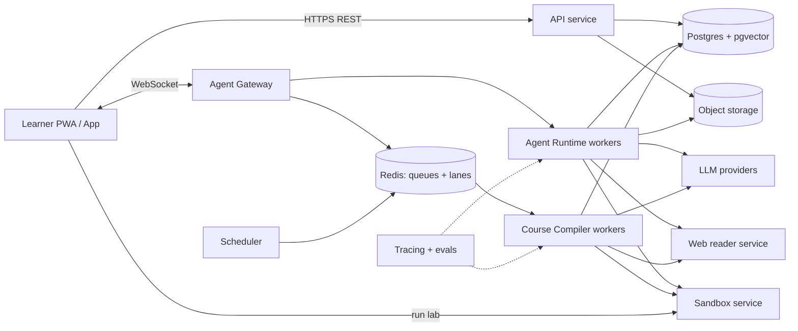
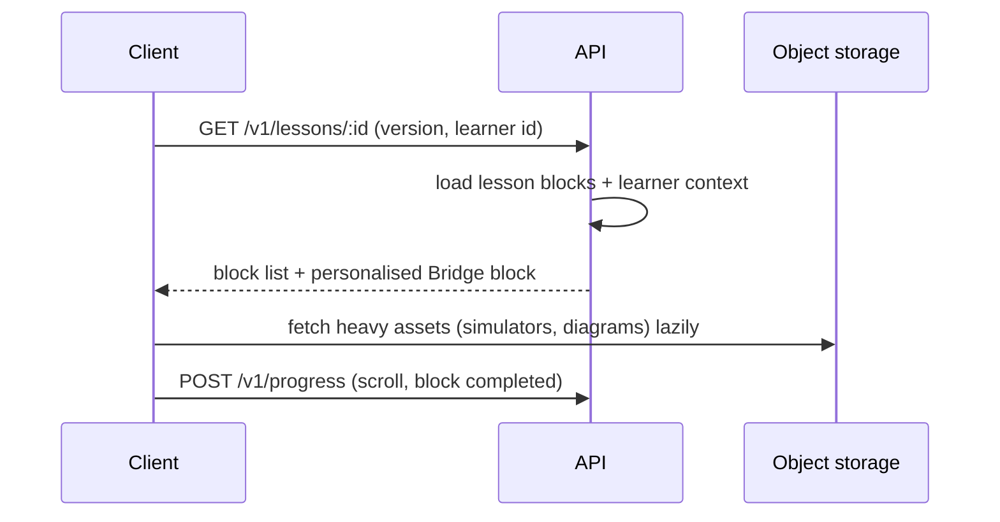
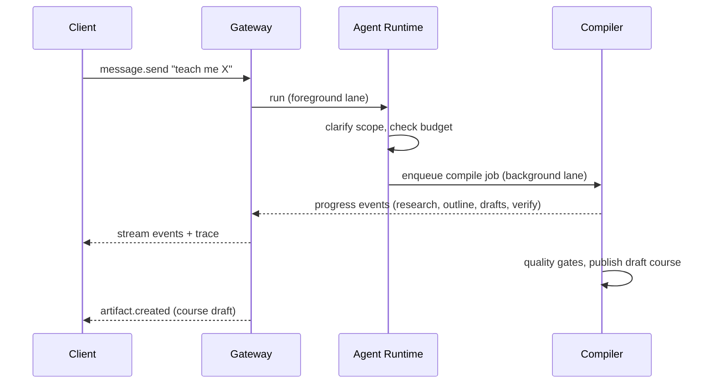

# Architecture — Atlas // OS

**Status:** Draft v0.1

## 1. Goals and constraints

- **Mobile-first PWA**, later wrapped or rebuilt in React Native for camera/voice.
- **Content is the product.** The system must create, verify, version, and serve large lesson trees cheaply.
- **Agent is long-running.** Jobs outlive the app session; progress streams back.
- **Safe execution** of untrusted code and untrusted web content.
- **Small-team friendly.** Prefer managed services and boring tech; keep model providers swappable.

## 2. System context

## 3. Components

| Component | Responsibility | Suggested tech |
|---|---|---|
| **Client** | Dock UI, reader, simulators, Pyodide runner, offline cache, voice/camera capture | Next.js (React, TypeScript, Tailwind, Framer Motion), service worker, IndexedDB |
| **API service** | Auth, courses, progress, mastery, Vault, billing, uploads | Node/TypeScript (Fastify or Nest) or Next route handlers |
| **Agent Gateway** | Persistent WebSocket, sessions, lanes, queue modes, event streaming, auth, rate limits | Node/TypeScript, Redis |
| **Agent Runtime** | Run loop, tools, sub-agents, memory read/write, skills | Python (FastAPI + LangGraph or equivalent) |
| **Course Compiler** | Research → outline → draft → verify → publish (`COURSE_ENGINE_SPEC.md`) | Python workers, job queue |
| **Web Reader** | Search, headless browse, extract, cache; hardened against SSRF | Playwright pool, search API, readability extraction |
| **Sandbox service** | Run lab code with limits (`LABS_SANDBOX_SPEC.md`) | In-browser Pyodide; server microVMs (Firecracker-based provider) |
| **Memory service** | Layers, learner model, retrieval (`MEMORY_PERSONALIZATION_SPEC.md`) | Postgres + pgvector, background consolidators |
| **Scheduler** | Daily Pulse, SRS reminders, freshness checks, cost rollups | Cron + queue |
| **Observability** | Traces, logs, cost, content/agent evals | OpenTelemetry, Langfuse-style tracing, Sentry |

## 4. Key flows

### 4.1 Open a lesson

### 4.2 Ask Atlas to build a course

### 4.3 Run a lab

Client picks the tier from the lab manifest (Pyodide or server). Code + tests go to the sandbox; results stream back; the Governor decides whether to reveal hints; mastery and review cards update.

## 5. Decisions (ADRs)

| ADR | Decision | Why | Revisit when |
|---|---|---|---|
| 001 | **PWA first**, native later | Fastest to ship, one codebase, shareable links | Camera/voice quality needs native APIs |
| 002 | **TypeScript gateway + Python agent runtime** | Node is strong at sockets; Python has the best agent/ML ecosystem | Ops cost of two runtimes outweighs benefits |
| 003 | **Postgres + pgvector** as the single primary store | Fewer moving parts; transactional content + vectors | > ~10M chunks or heavy ANN latency |
| 004 | **Redis for lanes/queues** | Simple ordered queues, pub/sub for events | Need durable workflows (move to Temporal or similar) |
| 005 | **Typed-block lesson format (JSON/MDX)** | Rendering, verification, personalisation, and versioning all need structure | — |
| 006 | **Model-agnostic adapter** | Cost and quality change fast; free-tier models for drafts, stronger models for verification | — |
| 007 | **Pyodide-first labs**, server microVM for heavy languages | Zero server cost for Python labs; phones can run it | Pyodide load time too slow on target devices |
| 008 | **Verification before publish** | Trust is the product | — |
| 009 | **Per-user virtual file tree** (`/atlas/skills`, `/atlas/codex`) stored in DB/object storage | Portable, exportable, no real filesystem access | — |

## 6. Data and storage

- **Postgres:** users, courses, versions, blocks, progress, mastery, cards, sessions, jobs (`DATA_MODEL_AND_API.md`).
- **pgvector:** lesson chunks, learner memories, source passages.
- **Object storage:** simulator bundles, diagrams, user uploads, audio, exports, course packs.
- **Redis:** session lanes, job queues, rate-limit counters, short-lived caches.
- **IndexedDB (client):** offline modules, drafts, unsent messages, review queue.

## 7. Jobs and queues

| Queue | Examples | Notes |
|---|---|---|
| `foreground` | chat turns, tool calls | Low latency, per-session serial |
| `background` | course compile, deep research | Resumable, checkpointed, cancellable |
| `verify` | run reference solutions, citation checks | Sandbox-heavy, rate-limited |
| `maintenance` | freshness checks, embeddings, consolidation | Off-peak |

All jobs have: idempotency key, budget, timeout, retry policy, and a checkpoint so a crash resumes instead of restarting.

## 8. Realtime

WebSocket with a typed event envelope (`DATA_MODEL_AND_API.md`). Reconnect with `last_event_id` replay. If WebSocket is blocked, fall back to Server-Sent Events plus POST.

## 9. Scaling and cost

- **Biggest cost drivers:** course compilation, parallel web browsing, vision, TTS.
- **Controls:** budgets, caching of fetched pages and embeddings, small models for drafting, batch APIs for offline compile, dedupe of identical research across users, compile once → serve many.
- **Reads dominate** (published lessons): cache aggressively at the CDN; personalisation limited to a thin overlay (Bridge blocks, difficulty hints).
- Track **cost per lesson compiled** and **cost per active learner per month** from day one.

## 10. Observability and evaluation

- Trace every agent run: prompt versions, tools, tokens, latency, cost.
- **Content evals:** automatic checks on every lesson version (code runs, tests pass, links resolve, numeric claims checked, rubric score).
- **Agent evals:** replay suites for research quality, injection resistance, and Governor leakage (does it reveal solutions?).
- Dashboards: lab pass rate, hint usage, drop-off points per lesson, error reports.

## 11. Environments and delivery

`dev` (local, mocked LLM) → `staging` (real providers, small budgets) → `prod`. CI runs type checks, unit tests, lesson-schema validation, and a smoke compile of a tiny course. Feature flags for agent capabilities.

## 12. Failure modes

| Failure | Behaviour |
|---|---|
| LLM provider outage | Fail over to secondary provider; degrade to cached content |
| Sandbox unavailable | Show lab as "read-only"; queue run; never fall back to unsandboxed execution |
| Web reader blocked/poisoned | Mark source unreliable; agent must say so in the answer |
| Compile job crash | Resume from checkpoint; partial course stays unpublished |
| Budget exhausted mid-job | Pause with a clear message; allow user to extend |

## 13. Open questions

- Single deployable monolith for MVP, or split gateway/runtime from day one?
- Which sandbox provider (cost, cold-start, language support)?
- Where does the course compiler run for free-tier users (queue delay vs. cost)?
