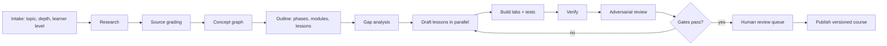

# Course Engine Spec

**Status:** Draft v0.1
**Scope:** Content hierarchy, lesson block format, fan-out, the course compiler pipeline, quality gates, versioning.

---

## 1. Hierarchy

```
Course
 └─ Phase            (4–5 per course)
     └─ Module       (10–20+ per course; ~8–12 lessons each)
         └─ Lesson   (long-form chapter, ~25–40 min incl. lab)
             ├─ Blocks      (typed, ordered)
             ├─ Fan-out branches (nested lessons, any depth)
             └─ Attachments: Lab(s), Paper(s), X-Ray tour(s), Case study
```

Courses are a **DAG**, not a strict line: modules declare prerequisites (`requires: [module_id]`) so placement and skipping work.

## 2. Lesson blocks

| Block | Purpose | Notes |
|---|---|---|
| `bridge` | "From what you know" callout | Generated per learner from the profile; falls back to a generic bridge |
| `narrative` | Long-form explanation | Naive solution → why it breaks → production algorithm |
| `fanout` | Inline marker + branch reference | Opens a nested lesson or a short side-quest |
| `math` | Decoder-enabled equation | Symbols map to text, code line, and live value |
| `simulator` | Embedded interactive | Deterministic, seedable, pausable; has an accessible text fallback |
| `xray` | Codebase tour | Commit-pinned stops with file/symbol/permalink |
| `paper` | Annotated primary source | Link + our own summary + annotations; no long copied text |
| `lab` | Ghost-slot build or Saboteur bug-hunt | Manifest in `LABS_SANDBOX_SPEC.md` |
| `checkpoint` | Quick retrieval question | Feeds mastery and SRS |
| `teachback` | One-sentence explanation | Rubric-scored |
| `review` | Staff-engineer comment on lab work | Generated after tests pass |
| `callout` | Warning, pitfall, production note | |
| `claim` | Wrapper that attaches sources and a verification status to a statement | See §6 |

### Block example

```json
{
  "id": "blk_5_4_math_waf",
  "type": "math",
  "latex": "\\text{WAF} \\approx \\ldots",
  "symbols": [
    {"token": "T", "role": "Size ratio between levels", "code_ref": {"file": "lsm_sim.py", "line": 28}, "live": {"var": "T", "min": 2, "max": 20, "default": 10}}
  ],
  "sources": [{"id": "src_oneil_1996"}, {"id": "src_rocksdb_wiki@sha"}],
  "status": "verified"
}
```

## 3. Fan-out semantics

- A `fanout` block references a **branch** (a lesson or mini-lesson) with a `kind`: `prerequisite`, `deep_dive`, `history`, `example`.
- Opening a branch records a **context commit** (scroll position, selection).
- Closing/merging returns to the same position and stores a **merge summary** (1–2 sentences) the learner can see and edit.
- Branches can nest, with a UI depth limit (default 3) and a breadcrumb trail.
- Branch content is either **pre-built** (shared by all learners) or **generated on demand** by the agent, then cached and optionally promoted into the course after review.

## 4. Compiler pipeline



| Stage | Output | Owner role |
|---|---|---|
| Intake | Scope, audience, depth, constraints, budget | Planner |
| Research | Source set with `{url, fetched_at, hash}` | Researcher |
| Source grading | Reliability score per source (primary > official docs > reputable blog > forum) | Researcher |
| Concept graph | Concepts + prerequisite edges | Planner |
| Outline | Phases → modules → lesson titles with learning objectives | Planner |
| Gap analysis | Missing prerequisites, unclear jumps, unsupported claims | Gap analyst |
| Drafting | Lesson blocks | Writer (parallel workers) |
| Labs | Reference solution, tests, ghost-slots, Saboteur variants | Lab builder |
| Verify | Automated checks (§5) | Verifier |
| Review | Rubric scores and issue list | Reviewer |
| Human review | Spot-checks and flagged items | Reviewer (human) |
| Publish | `course_version` | System |

The compiler is **resumable** (checkpoint per stage and per lesson) and **cost-aware** (estimate shown before start; stops at budget).

### Staging for big courses

For a 100+ lesson course, compile **module by module**: outline the whole course first, then fully build and verify Module 1 as a pilot, review quality, and only then scale to the rest.

## 5. Quality gates (CE-)

| ID | Gate | Pass condition |
|---|---|---|
| CE-1 | **Schema** | All blocks valid; IDs unique; prerequisites acyclic |
| CE-2 | **Code runs** | Every code block executes in the sandbox (or is marked illustrative) |
| CE-3 | **Labs solvable** | Reference solution passes all tests; ghost-slot starter fails tests; each Saboteur variant fails exactly the intended test |
| CE-4 | **Citations resolve** | URLs reachable (or archived); quotes < short limit; no long verbatim copying |
| CE-5 | **Numeric claims** | Numbers, defaults, and formulas have a source or are reproduced by a script in the sandbox |
| CE-6 | **Code references** | File/symbol exists at the pinned commit; permalink resolves |
| CE-7 | **Coverage** | Each learning objective is taught, practised, and checked |
| CE-8 | **Readability** | Reading-level and length targets; no undefined jargon on first use |
| CE-9 | **Rubric score** | Reviewer score above threshold on accuracy, clarity, depth, pedagogy |
| CE-10 | **Safety/licence** | Licence check on repos and papers; no disallowed content |

Failing blocks are repaired and re-verified; after N failures they are marked `needs_human`.

## 6. Provenance and status

Every factual statement can be wrapped in a `claim` with:
- `sources[]` (IDs into the `sources` table)
- `status`: `verified` (source or script confirms) · `model_written` (plausible, not independently confirmed) · `disputed` (conflicting sources)
- `confidence` 0–1 and `last_checked_at`

UI shows a small badge; tapping reveals sources. Courses may not publish with unresolved `disputed` claims unless they are labelled as such in the text.

## 7. Versioning and freshness

- `course_version` is immutable once published; edits create a new version with a changelog.
- Learners stay on their version until they choose to upgrade; the UI shows "what changed".
- **Freshness job:** weekly check of pinned repos/docs/papers for new releases or corrections; flags affected lessons for re-verification.
- X-Ray tours re-validate against new commits and offer an updated tour when stable.

## 8. Community courses (P2)

Fork a course → edit → request review → publish as a variant. Original author credit and licence are preserved. Error reports (`PRODUCT_REVIEW.md` A15) feed a triage queue with SLA targets.

## 9. Metrics

Per lesson: start→finish rate, median time, drop-off block, checkpoint accuracy, lab pass rate, hint level distribution, error reports, Teach-Back score. Per course: cost to compile, % blocks verified, % needs_human, learner outcomes.

## 10. Open questions

- Minimum human review per lesson at launch (all lessons vs. sampled)?
- Which language(s) for labs at launch (Python only, or Python + Rust/Go via server)?
- Licensing stance for community-forked courses?
