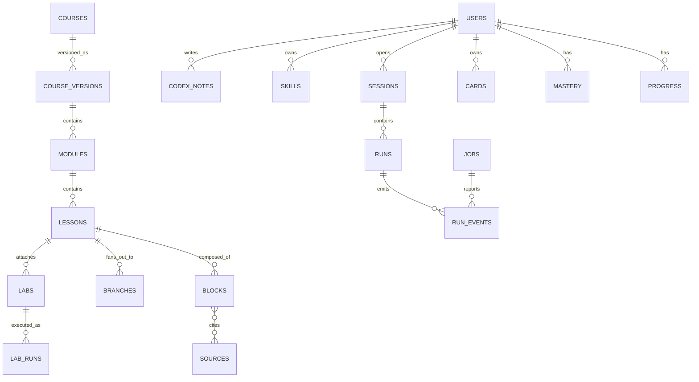

# Data Model and API

**Status:** Draft v0.1
**Scope:** Core database schema, REST endpoints, WebSocket protocol. Types are Postgres; IDs are prefixed ULIDs (e.g. `crs_...`).

---

## 1. Entity overview



## 2. Core tables (DDL sketch)

```sql
-- Identity
create table users (
  id text primary key,
  email text unique not null,
  display_name text,
  plan text not null default 'free',
  created_at timestamptz not null default now()
);

create table profiles (
  user_id text primary key references users(id) on delete cascade,
  user_md text not null default '',          -- the USER.md content
  settings jsonb not null default '{}'
);

-- Content
create table courses (
  id text primary key,
  slug text unique not null,
  title text not null,
  domain text not null,
  owner_id text references users(id),
  visibility text not null default 'private'   -- private | unlisted | public
);

create table course_versions (
  id text primary key,
  course_id text not null references courses(id),
  version int not null,
  status text not null,                        -- draft | in_review | published | archived
  changelog text,
  created_at timestamptz not null default now(),
  unique (course_id, version)
);

create table modules (
  id text primary key,
  course_version_id text not null references course_versions(id),
  phase int not null,
  position int not null,
  title text not null,
  requires text[] not null default '{}'        -- module ids (DAG)
);

create table lessons (
  id text primary key,
  module_id text not null references modules(id),
  position int not null,
  title text not null,
  est_minutes int,
  mastery_tags text[] not null default '{}',
  parent_lesson_id text references lessons(id), -- non-null for fan-out branches
  branch_kind text                              -- prerequisite | deep_dive | history | example
);

create table blocks (
  id text primary key,
  lesson_id text not null references lessons(id),
  position int not null,
  type text not null,
  body jsonb not null,
  status text not null default 'model_written', -- verified | model_written | disputed
  confidence real,
  last_checked_at timestamptz
);

create table sources (
  id text primary key,
  url text not null,
  title text,
  kind text,                                    -- paper | repo | docs | blog | video
  pinned_ref text,                              -- commit SHA / version
  content_hash text,
  license text,
  fetched_at timestamptz
);

create table block_sources (
  block_id text references blocks(id) on delete cascade,
  source_id text references sources(id),
  primary key (block_id, source_id)
);

create table labs (
  id text primary key,
  lesson_id text not null references lessons(id),
  manifest jsonb not null,                      -- see LABS_SANDBOX_SPEC.md
  reference_ref text not null                   -- private storage key, never sent to clients
);

-- Learning state
create table progress (
  user_id text references users(id) on delete cascade,
  lesson_id text references lessons(id),
  status text not null,                         -- started | completed
  last_block_id text,
  updated_at timestamptz not null default now(),
  primary key (user_id, lesson_id)
);

create table mastery (
  user_id text references users(id) on delete cascade,
  concept text not null,
  score real not null,
  uncertainty real not null,
  updated_at timestamptz not null default now(),
  primary key (user_id, concept)
);

create table cards (
  id text primary key,
  user_id text not null references users(id) on delete cascade,
  source_block_id text references blocks(id),
  kind text not null,                           -- cloze | short | predict | spot_bug
  front jsonb not null,
  back jsonb not null,
  stability real, difficulty real,
  due_at timestamptz not null,
  last_reviewed_at timestamptz
);

create table lab_runs (
  id text primary key,
  user_id text not null references users(id) on delete cascade,
  lab_id text not null references labs(id),
  tier text not null,
  passed boolean,
  hint_level_max int not null default 0,
  duration_ms int,
  created_at timestamptz not null default now()
);

-- Agent
create table sessions (
  id text primary key,
  user_id text not null references users(id) on delete cascade,
  context jsonb not null default '{}',          -- lesson id, selection, etc.
  created_at timestamptz not null default now()
);

create table runs (
  id text primary key,
  session_id text not null references sessions(id) on delete cascade,
  lane text not null,
  status text not null,                         -- running | done | cancelled | failed
  cost_usd numeric(10,4) not null default 0,
  budget_usd numeric(10,4),
  started_at timestamptz not null default now(),
  ended_at timestamptz
);

create table run_events (
  id text primary key,
  run_id text not null references runs(id) on delete cascade,
  seq bigint not null,
  type text not null,
  data jsonb not null,
  ts timestamptz not null default now(),
  unique (run_id, seq)
);

create table jobs (
  id text primary key,
  kind text not null,                           -- compile_course | deep_research | verify | ...
  user_id text references users(id),
  status text not null,
  checkpoint jsonb,
  budget_usd numeric(10,4),
  cost_usd numeric(10,4) not null default 0,
  created_at timestamptz not null default now()
);

-- Memory, skills, codex
create table memories (
  id text primary key,
  user_id text not null references users(id) on delete cascade,
  layer text not null,                          -- L2 | L3
  text text not null,
  embedding vector(1536),
  source text not null,                         -- stated | inferred | system
  confidence real not null,
  last_used_at timestamptz,
  created_at timestamptz not null default now()
);

create table skills (
  id text primary key,
  user_id text not null references users(id) on delete cascade,
  name text not null,
  version int not null,
  body text not null,                           -- SKILL.md
  status text not null,                         -- candidate | active | retired
  test_report jsonb,
  unique (user_id, name, version)
);

create table codex_notes (
  id text primary key,
  user_id text not null references users(id) on delete cascade,
  path text not null,                           -- /atlas/codex/...
  body text not null,
  updated_at timestamptz not null default now(),
  unique (user_id, path)
);
```

Row-level security: every learner-owned table is filtered by `user_id = current_user`.

## 3. REST API (v1)

Auth: OAuth (Google) → session token. JSON over HTTPS. Errors: `{ "error": { "code", "message", "details?" } }`. Pagination: `?cursor=&limit=`.

| Area | Method + path | Purpose |
|---|---|---|
| Auth | `POST /v1/auth/google` | Sign in |
| Profile | `GET/PUT /v1/me`, `GET/PUT /v1/me/user-md` | Profile and USER.md |
| Courses | `GET /v1/courses` | Browse |
| | `GET /v1/courses/:id` | Course with phases/modules summary |
| | `GET /v1/modules/:id` | Lessons list + attachments |
| Lessons | `GET /v1/lessons/:id` | Blocks + personalised overlay |
| | `GET /v1/lessons/:id/branches` | Fan-out branches |
| | `POST /v1/lessons/:id/branches` | Generate a branch on demand (queues job) |
| Progress | `POST /v1/progress` | Record block/lesson progress |
| | `GET /v1/me/mastery` | Competency graph |
| Labs | `GET /v1/labs/:id` | Manifest (no reference solution) |
| | `POST /v1/labs/:id/runs` | Submit code → run result or stream URL |
| | `POST /v1/labs/:id/hint` | Request next hint level |
| | `POST /v1/labs/:id/teachback` | Submit Teach-Back |
| Review | `GET /v1/me/reviews/due` | Due cards |
| | `POST /v1/me/reviews/:cardId` | Submit grade |
| Vault | `GET /v1/me/codex`, `PUT /v1/me/codex/*path` | Notes |
| | `GET /v1/me/journey` | Timeline |
| | `GET /v1/me/skills`, `PATCH /v1/me/skills/:id` | View/enable/disable |
| | `GET/DELETE /v1/me/memories` | Memory controls |
| | `POST /v1/me/export` | Export job |
| Agent | `POST /v1/sessions` | Create session |
| | `GET /v1/runs/:id/events?after=` | Event replay |
| | `GET /v1/jobs/:id` | Job status + cost |
| Pulse | `GET /v1/pulse` | Feed |
| Reports | `POST /v1/blocks/:id/report` | Content issue |
| Share | `POST /v1/proof-cards` | Create shareable card (confirmation required) |

Rate limits by plan; heavy endpoints (`runs`, `branches`, `jobs`) use token-bucket limits plus budgets.

## 4. WebSocket protocol

Endpoint: `wss://…/v1/ws?session_id=…` (token in subprotocol/header).

**Client → server**

```json
{ "type": "message.send", "client_id": "c_123", "text": "Explain write stalls", "context": {"lesson_id": "les_5_4", "selection": "…"}, "mode": "steer" }
{ "type": "run.steer", "run_id": "run_…", "text": "focus on NVMe case" }
{ "type": "run.cancel", "run_id": "run_…" }
{ "type": "confirm.action", "action_id": "act_…", "approve": true }
{ "type": "session.resume", "last_event_id": "evt_…" }
```

**Server → client:** the event envelope in `AGENT_HARNESS_SPEC.md` §12.

**Guarantees**
- At-least-once delivery with `seq` per run; client de-dupes.
- On reconnect, replay from `last_event_id`.
- Server sends `ping` every 20 s; idle timeout 60 s.
- Backpressure: if the client is slow, the server coalesces `message.delta` events.

## 5. Versioning and compatibility

- API versioned in the path; additive changes only within `v1`.
- Lesson block schema versioned (`schema_version`) with migrations; clients ignore unknown block types gracefully (show a fallback card).

## 6. Open questions

- Single `blocks.body` JSON vs. per-type tables (start with JSON; split if querying needs grow).
- Event retention: how long do we keep `run_events` (cost vs. replay value)?
