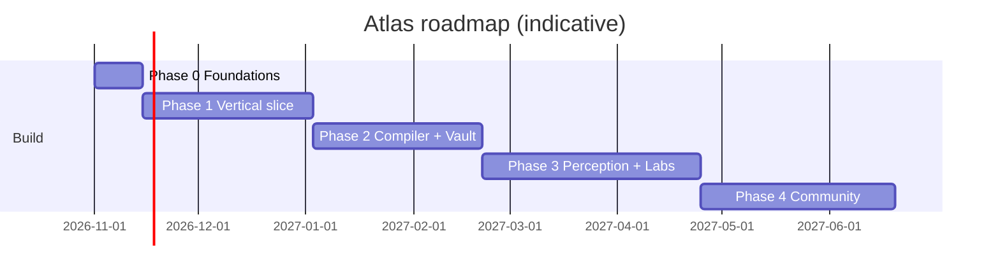

# Roadmap — Atlas // OS

**Status:** Draft v0.1
**Assumption:** a very small team (1–2 builders). Timelines are **indicative**; re-estimate after Phase 1.

**Strategy:** prove the learning loop on **one excellent module**, then automate content creation, then widen the agent. Don't build the whole OS before one lesson is great.

---

## Phase 0 — Foundations (≈ 2 weeks)

- Repo, CI, design tokens, block schema + validator
- Auth (Google), Postgres, basic API
- Typed-block renderer (narrative, callout, claim badge)
- Decide: first learner, flagship module, model strategy (`PRODUCT_REVIEW.md` §5)

**Exit:** a hand-written lesson renders on a phone, with provenance badges.

## Phase 1 — Vertical slice MVP (≈ 6–8 weeks)

**Scope: one module (~12 lessons) — e.g. "LSM-Trees and Compaction".**

- Courses tab (one course, module/lesson list, progress)
- Studio: fan-out, Math Decoder, 2 simulators (compaction, write stall), X-Ray (commit-pinned), Bridge block
- Labs: Pyodide ghost-slot labs with tests + Hint Ladder + Teach-Back
- Mastery v0 + spaced repetition (FSRS) + due-queue
- Agent Atlas v0: chat with lesson context, `atlas.web` (read-only, cited), Agent Trace + cost meter
- Verification scripts for the module (CE-1…CE-6 run in CI)
- 10–20 real learners; instrument everything

**Exit criteria (go/no-go to Phase 2):**
- ≥ 60% lesson completion, ≥ 50% lab pass with ≤ 3 hints
- D7 retention ≥ 25% among invited learners
- < 1 content error report per 1,000 views
- Qualitative: learners can explain the module's core ideas in their own words

## Phase 2 — Compiler and Vault (≈ 6–8 weeks)

- Course compiler v1: outline → draft → verify → review for a **10-lesson mini-course**
- Resumable jobs, budgets, cost estimates, quality gates, human-review queue
- `atlas.create` (plan + compile), approval step before spend
- Vault: Codex generation, `/journey`, memory controls, export
- Placement diagnostic v1 (adaptive skip)
- Branch/merge for on-demand fan-out
- Pulse v0: weekly curated deconstruction with "turn into a course"

**Exit:** a generated mini-course scores within an agreed margin of the hand-built module on learner outcomes and error rate, at a known cost per lesson.

## Phase 3 — Perception, Server Labs, Offline (≈ 8–10 weeks)

- Camera/image understanding, PDF reading, screen context
- Voice conversation (1–2 TTS providers) and Commute Mode audio lessons
- Server microVM labs (Rust/Go/C++), quotas
- Offline packs (modules + review queue)
- Failure Museum (first 3 post-mortems)
- Cluster Simulator v1 (Raft module)
- Portfolio export + Proof cards

## Phase 4 — Community and Ecosystem (≈ 8+ weeks)

- Community courses, forks, review pipeline, error-report bounties
- Study squads and lab PR reviews
- Interview Mode
- Atlas MCP server (Codex/skills available to coding tools)
- Native shell (React Native) if PWA limits camera/voice quality
- Multilingual lessons; light theme; deeper accessibility pass

---

## Milestone map

## Budget and cost tracking

Track from Phase 1, review monthly:

| Metric | Why |
|---|---|
| Cost per lesson compiled | Is the compiler economical? |
| Cost per active learner per month (agent + sandbox) | Pricing and free-tier design |
| Sandbox minutes per lab | Server-lab quotas |
| Cache hit rate (web, embeddings, lesson overlays) | Biggest cost lever |
| Verification failure rate by gate | Where content quality breaks |

Set explicit monthly caps per environment; alert at 70% and 90%.

## Kill and pivot criteria

| Signal | Action |
|---|---|
| Phase 1 completion/lab-pass targets missed twice after iteration | Fix pedagogy before building more features; consider shrinking to a lab-first product |
| Generated lessons need > X% human rewrite | Keep human-authored flagship courses; limit the agent to Q&A and branches |
| Cost per active learner exceeds revenue plan | Tighten budgets, shift drafting to small models, gate heavy tools behind Pro |
| Mobile labs unreliable on target devices | Make server labs the default; keep Pyodide for light labs only |
| Heavy safety or legal friction on web/paper features | Narrow to curated sources; remove open-web browsing from defaults |

## Risks tracked

See `PRODUCT_REVIEW.md` §2 (R1–R10) and `SECURITY_AND_SAFETY.md` §2 (T1–T15). Review at the end of each phase.

## Next 10 days (suggested)

1. Pick the flagship module and write its lesson outline (12 lessons, with objectives).
2. Finalise the block schema and build the renderer for 5 block types.
3. Hand-write Lesson 1 fully, including one simulator and one ghost-slot lab with tests.
4. Test it on 3 real phones (iOS + Android) for readability and Pyodide load time.
5. Show it to 5 learners; record where they stall.
